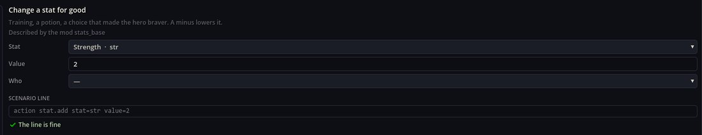
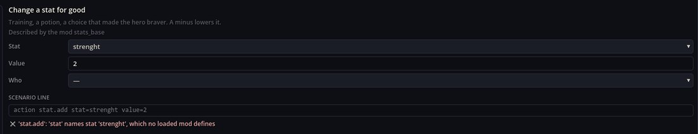
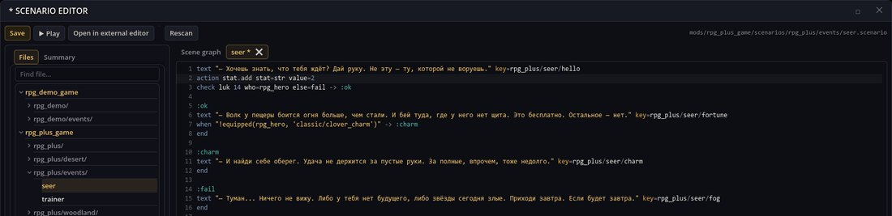

# Schema Tools — Trình sửa dữ liệu và bảng lệnh

Schema Tools là hai cửa sổ dành cho tác giả, được dựng hoàn toàn từ những mô tả mà các mod mang theo dưới dạng lược đồ (xem mod Schemas):

- **Trình sửa dữ liệu** sửa bằng biểu mẫu các thực thể thuộc mọi loại đã mô tả — chỉ số, lớp, vật phẩm, nhân vật, hành động chiến đấu, cửa hàng, công thức chế tạo;
- **bảng lệnh** viết một dòng kịch bản từ biểu mẫu, kiểm tra nó rồi đặt vào trình sửa kịch bản.

Cả hai cửa sổ đều không biết trước loại hay hành động nào: những gì các mod đã tải mô tả sẽ hiện ra trong đó. Cả hai mở từ hộp công cụ trên thanh công cụ của game, khi game đang chạy.

## Trình sửa dữ liệu

Chọn mod ở trên, loại dữ liệu bên trái và một mục ở giữa; biểu mẫu ở bên phải. Đây là thanh kiếm sắt của Classic RPG Rules trong RPG Plus:

Hình trình sửa được chụp trước đây. Khóa `rpg_demo/` hoặc bảng `rpg_tileset` trong hình là của bản cũ; dùng khóa `rpg_plus/` và mô hình `rpg_object` hiện tại trong bài.

Biểu mẫu gom trường của nhiều mod vào một: Id, tên, mô tả, giá, ảnh, kiểu vật phẩm và hành động vật phẩm do Items Engine mô tả; **Equip type**, danh sách **Traits** (một chỉ số, một lượng) và các lớp được phép mặc do Equipment thêm vào. Loại mà hai mod cùng mô tả vẫn chỉ có một biểu mẫu.

- **Văn bản** (`Name`, `Description`) hiện dưới dạng khóa dịch của nó và một dòng cho mỗi ngôn ngữ của mod; chúng được ghi vào tệp bản địa hóa của chính mod.
- **Tham chiếu** (một chỉ số, vật phẩm, lớp) là danh sách các id mà game biết.
- **Danh sách** như traits có một thẻ cho mỗi phần tử với trường riêng của nó.
- Những thuộc tính mà không lược đồ nào mô tả vẫn được giữ và hiện trong phần trường khác dưới dạng JSON.

Thanh công cụ: **Mới** (Ctrl+N) thêm một mục với giá trị mặc định của lược đồ, **Sao chép** (Ctrl+D) nhân bản mục đang chọn, **Xóa** hỏi trước, **Hoàn tác**/**Làm lại** (Ctrl+Z / Ctrl+Y hoặc Ctrl+Shift+Z) đi qua các thay đổi, **Lưu** (Ctrl+S) chỉ ghi những tệp đã đổi, với kết thúc dòng LF. Ngay sau khi lưu, game đang chạy thấy thay đổi: một vật phẩm mới có thể được trao và mặc mà không cần khởi động lại.

Danh sách hiển thị các mục của mod đã chọn và, nếu đánh dấu **Entries of other mods**, các mục của các mod phụ thuộc, có ghi `↗ chủ sở hữu`. Sửa một mục như vậy sẽ ghi một bản vá vào mod đã chọn (`patches/<loại>/<mod>.json`) chỉ với các giá trị đã đổi; tệp của chủ sở hữu giữ nguyên từng byte. **Reset to inherited** xóa bản vá, còn **↺** cạnh một trường xóa giá trị của bạn ở trường đó.

## Bảng lệnh

Chọn một hành động hoặc lệnh bên trái (tìm theo những từ như "sát thương", "vật phẩm", "check"), điền biểu mẫu, và dòng lệnh hiện ra bên dưới:

Dòng được kiểm tra ngay khi bạn gõ, theo đúng luật của Validator. Một chỉ số gõ sai:

**Chèn** đặt dòng vào kịch bản đang mở trong trình sửa kịch bản, dưới con trỏ; **Sao chép** đưa nó vào bộ nhớ tạm. Kịch bản của nữ tiên tri trong RPG Plus sau khi chèn:

Trường `flag` có một ô **self.**: khi đánh dấu, dòng lệnh ghi cờ của đối tượng đang chạy hội thoại (`flag self.picked 1`). Một `self.` trơ không có tên được hiển thị dưới dòng như lỗi; **Chèn** không dừng lại vì điều đó, nên hãy sửa tên trước.

Không có gì được ghi xuống đĩa cho tới khi tác giả nhấn **Lưu** trong trình sửa kịch bản. Văn bản kịch bản vẫn là nguồn sự thật duy nhất: bảng lệnh chỉ giúp viết nó.

## Khi có trục trặc

1. **Thiếu một loại hoặc một hành động.** Không mod nào đã tải mô tả nó trong lược đồ; trang Schemas giải thích cách thêm.
2. **Danh sách mod trống.** Không có mod nào ghi được (chỉ ghi được vào mod cài dưới dạng thư mục; mod đã đóng gói thì không).
3. **Chèn báo chưa mở kịch bản nào.** Hãy mở một kịch bản trong trình sửa kịch bản trước, hoặc dùng Sao chép.
4. **Một trường là ô văn bản thường.** Kiểu của nó trong lược đồ là text hoặc không rõ.

## Trường bổ sung

`quests_base`, `skills_base`, `turn_battle_base` mô tả nhiệm vụ, kỹ năng, trạng thái. Bước nhiệm vụ có số và văn bản từng ngôn ngữ; loại và hành động dùng bộ chọn. Trường cờ có **self.** để tạo `flag self.picked 1`. `self.` thiếu tên là sai; sửa trước khi chèn.
